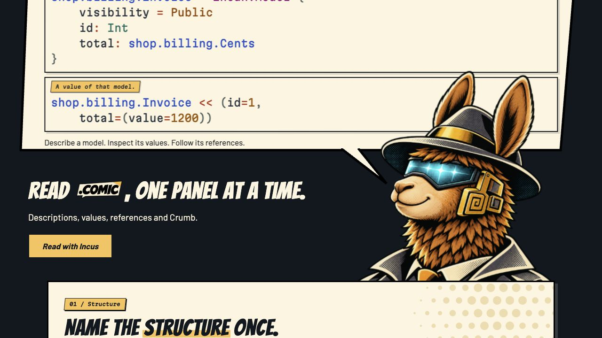
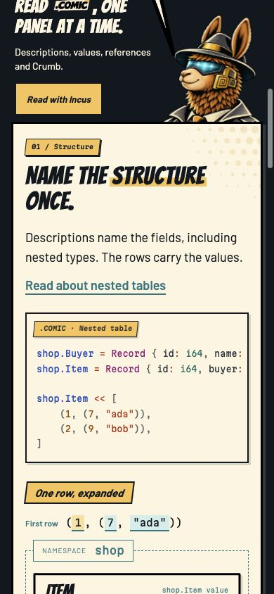
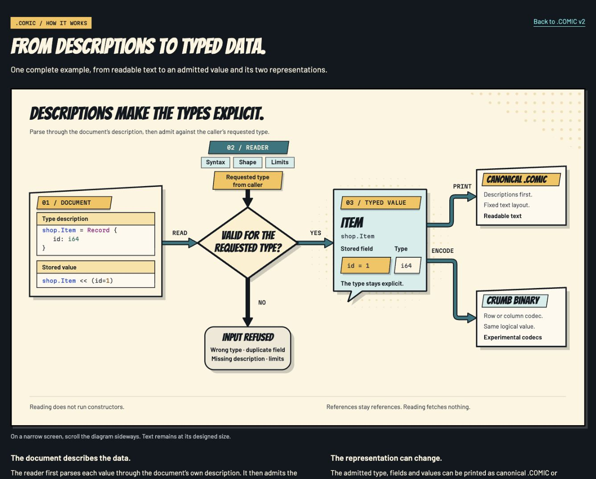

# .COMIC approved release style

**Pinned visual baseline: Edition 02, approved 9 November 2026.**

Use this comic-book direction for the eventual .COMIC website release. The approval covers visual design; the format, implementation status and content may continue to evolve. Edition 02 identifies this website design exploration, not a released format version.

- [Approved front page](v2/)
- [Original design, preserved](./)
- [How it works](assets/how-it-works.html)
- [Pinned source](../tools/comic/)
- [Artifact and source fingerprints](publication-receipt.json)

## Palette and typography

| Role | Approved value |
| --- | --- |
| Ink | `#111820` |
| Paper | `#fff4df` |
| Amber | `#ffc15a` |
| Teal | `#00777e` |
| Cyan | `#48f0ef` |
| Paper rule | `#d6cbb9` |
| Display | Bangers |
| Body and controls | Barlow |
| Code and technical captions | Martian Mono, width 95, normal tracking, no code ligatures |
| Maker signature | Existing approved italic `by ENCERO` treatment and Lato wordmark proportions |

Use the included font files, logos and approved Built with INCAN stamp. Preserve their actual artwork and proportions.

## Composition and detail

- Keep dark outer gutters around framed paper chapters. Use ink outlines and restrained grey offset shadows.
- Retain angled amber chapter tabs, literal numbered topic labels and selected-word highlighting. Avoid extra heading underlines.
- Keep code blocks rectangular, with compact caption tabs and selectable source text. Code panels have no speech tails.
- Show the `shop` namespace around compact Item and nested Buyer value bubbles. Field values use small angled tags.
- Treat References as one connected code/dependency composition. Keep benchmark scales, numbers and limitations plain and readable.
- Generate geometric halftone from a regular grid. Clip amber dots into paper corners and use teal dots on dark panels, behind the content.
- Use Detective Incus as the narrator, with the distinct notebook/community scene at the bottom. The hero portrait is scaled to 91%, anchored at its bottom-right, inset to the chapter edge, and the speech tip stays clear of the visor.
- Preserve the saturated Punchy Paper palette and the selected Night palette. Declaration/path blue `#004fc4`, kind/literal magenta `#990078`, type teal `#007064`, strings/operators `#b82b14`, numbers `#9d5000`; technical field text remains dark ink.
- Keep brief existing glints/transitions secondary to reading, with reduced-motion support, paused-on-interaction example rotation and accessible controls.

## How-it-works diagram

Keep the explicit caller-requested type input. Use compact two-line caller labeling, straight inset document headers, 14px semibold ink labels and 26px decision text. Arrows are individual closed, filled SVG silhouettes with one ink outline, meeting their source and destination shapes. PRINT sits above the terminal horizontal segment. Preserve the final-validation wording note as a separate specification question; this visual pin does not resolve it.

## Approved captures

## Custody and release use

The baseline comes from approved source snapshot `6d105d53a585132fe1da13fdc739b3f53aaf421c`. The playground publication adds only a hosting-prefix option to the Incan emitter; with an empty prefix, all 50 original outputs are checked byte-for-byte against that snapshot. The public receipt records the mounted output hashes and source hashes without local machine paths.

The annotated Git tag `comic-style-edition-02-20261109` preserves this snapshot for release implementation. Keep that tag as the reference and develop later changes in new commits. The prototype's Edition 02 label is independent of release naming, which can pair **EDITION 01** with **v0.1.0** when an actual first release is made. This publication does not create a release.
