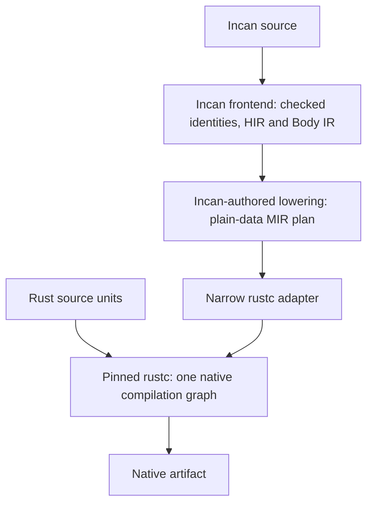
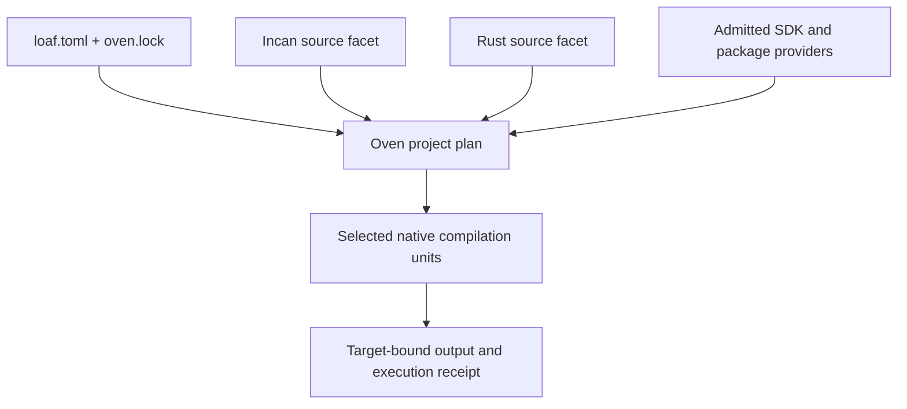

# Incan architecture · 0.6

0.6 separates source meaning, native compilation and project execution. Incan checks the program. The pinned rustc supplies the native compilation machinery. Oven owns the project graph, the selected build and its evidence.

??? info "0.6 design · in development"
    This page describes the release design, not a claim that the cutover has shipped. It follows the current [backend programme](https://github.com/encero-systems/incan/issues/652), [native frontend contract](https://github.com/encero-systems/incan/issues/1337) and [Incan-authored Oven direction](https://github.com/encero-systems/incan/issues/870). The current implementation and remaining acceptance work are tracked there. This website preview itself still builds with the installed 0.5.1 toolchain.

## The native compilation path

Incan becomes a second frontend to the exact rustc shipped with the toolchain. It does not translate the program into Rust source, on disk or in memory.

The driver runs the Incan frontend in-process. Declarations enter before rustc name resolution; checked bodies enter as MIR. Incan's checker owns language diagnostics, and its checked call plans carry the selected Rust signature, argument projections, callable ownership and source evidence. A rustc rejection of supplied MIR is a compiler defect, not a language rule discovered after code generation.

The lowering keeps rustc types out of the checker and Body IR. It builds a plain-data plan of blocks, places, calls and drops; the narrow adapter converts that plan into rustc MIR. rustc retains the jobs it is needed for: generic instantiation, trait resolution, async lowering and native code generation.

### What changes from the old page

| Old normal path | 0.6 design |
| --- | --- |
| Typed AST → Rust-oriented IR → `TokenStream` → formatted Rust source | Compiler-owned checked facts → declaration injection and MIR lowering |
| Generated Rust handed to a compiler as the program | Incan enters the pinned rustc through the driver interface |
| Generated names or layout can accidentally influence another tool's meaning | Canonical source identities and checked metadata carry meaning |
| Rust-source output stands in for native backend acceptance | Native execution, parity evidence and explicit migration decisions establish acceptance |

The Body IR interpreter was an earlier proof vehicle. It is not the shipping native backend. The full compiler frontend is also not being rewritten in Incan as a prerequisite: the native lowering, plan and orchestration are Incan-authored; the rustc-type adapter is the bounded Rust exception. See the [driver decision](https://github.com/encero-systems/incan/pull/2019) and [implementation contract](https://github.com/encero-systems/incan/issues/1337).

## Follow a build

1. **Read the project intent.** `loaf.toml` declares the package, sources, dependencies, target requirements and policy. `oven.lock` records the resolved graph.
2. **Select the graph and toolchain.** Oven selects the concrete units, providers, SDK, target and profile. The driver and its loaded compiler libraries must match the pinned identity.
3. **Check source meaning.** Incan resolves imports, aliases, declarations, types and calls into compiler-owned facts. Canonical identities survive package and facade boundaries.
4. **Lower the checked program.** The Incan-authored lowering prepares declarations and the MIR plan. The rustc adapter handles only the compiler-interface translation.
5. **Compile or reuse verified units.** Oven invokes the selected driver for Incan units and the appropriate pinned compiler path for Rust units. Reuse belongs to the selected unit identities, not to inferred generated-source paths.
6. **Publish the result and receipt.** The output is a native deliverable or a reusable target-bound asset, with the inputs, toolchain, selected units and resulting bytes recorded. Unsupported or stale requirements refuse rather than silently changing routes.

These are responsibilities in the target design, not six new CLI commands. Normal builds must produce no Rust source and invoke no Cargo. Existing generated-Rust fixtures and legacy execution remain comparison evidence during the cutover, not the new public contract.

## Incan and Rust in one project

A project may be Incan-only, Rust-only or mixed. A mixed project declares non-overlapping source roots; neither language is a generated copy of the other.

Incan sees Rust items through checked Rust inspection and call plans. Rust-hosted callers see eligible Incan exports through the caller namespace and identity contract. The same native graph must prove free calls, borrowed coercions, owned callbacks and calls from Rust into Incan. This is more than demonstrating that a scalar Rust function can be called once.

The driver is bound to the shipped rustc. An incompatible driver, stale metadata or mismatched compiler library must be rejected before compilation or publisher effects. See [#1337](https://github.com/encero-systems/incan/issues/1337), [RFC 097](../../RFCs/097_rust_hosted_incan_caller.md) and [RFC 119](../../RFCs/119_oven_native_rust_build_facets_and_cargo_interoperation.md).

## Who owns what

The dividing line is policy versus host mechanics. An Incan CLI calling a large Rust planner does not make the planner Incan-authored.

| Owner | Responsibilities |
| --- | --- |
| **Incan compiler** | Source meaning, canonical identities, checked declarations and bodies, types, call plans, diagnostics and compiler-service facts. |
| **Incan-authored native lowering** | The plain-data declaration/body plan, control flow, places, calls, ownership-driven drops and source evidence. |
| **Narrow rustc adapter** | Conversion into the pinned compiler's declaration and MIR interfaces. rustc-specific types remain here. |
| **Incan-authored Oven control plane** | Project graph, resolver/planner policy, build-unit and receipt models, invalidation policy, test/session scheduling and inspection/report construction. |
| **Bounded Rust host kernel** | Process supervision, pinned toolchain and platform mechanics, native linking, transport/signature primitives, platform handles and crash-safe publication. |
| **Runtime and package providers** | Declared implementation capabilities and admitted artifacts; they do not redefine source meaning or grant themselves host authority. |

Oven calls compiler service APIs; it must not shell out to the Incan CLI to learn semantics. Source and package declarations state their requirements. Project policy and host grants determine which effects can occur.

The older checked-in ownership audit still assigns more planning and store policy to Rust. It is historical evidence; it does not override the current migration acceptance in [#870](https://github.com/encero-systems/incan/issues/870) and [#1034](https://github.com/encero-systems/incan/issues/1034). Compiler frontend self-hosting and rewriting operating-system mechanics are explicitly outside that migration.

## Packages and shared facts

A public package is described by its checked interface, canonical declaration identities and admitted implementation content. A consumer must not recover its contract from producer-private Rust source or generated symbol spelling.

Executable representations describe the declarations they cover. Supported replacement consumers can use that published content without producer source; missing or incompatible coverage must be identified before an output or new execution receipt is published. Native linkage remains a separate admitted path. See [RFC 123](../../RFCs/123_package_executable_representation.md).

The CLI, LSP, Architect and other inspection consumers should project the same source and build facts. They need stable source ranges, identity, provenance and explicit stale-state behavior. They do not get a second semantic model by parsing generated Rust.

## Repository layout

All crates live under `loaves/`. The ring is an ownership boundary, not just a folder name.

| Ring | Owns |
| --- | --- |
| `kernel/` | Shared language and syntax contracts, canonical identity, semantic descriptors and codegraph records. |
| `compiler/` | Checking, HIR/Body IR, lowering, compiler/provider services, Rust inspection and the native compiler integration. |
| `oven/` | Language-neutral project, resolution, store, execution, provider and artifact machinery. |
| `stdlib/` | Component libraries and their explicitly declared implementation facets. |
| `toolchain/` | Executables and composition roots: the language command, language server, Oven command and pinned driver executable. |

Dependencies point inward. The compiler consumes Oven services as a client; Incan-specific Oven integration belongs to the compiler provider facet. Oven must not acquire compiler semantics through an arbitrary dependency or CLI subprocess. The native lowering belongs beside the checker in the compiler ring; the driver executable belongs in the toolchain ring.

## What must be proven

The target design is not established by a diagram or an open issue.

- **Native path:** an Incan program produces a binary with no generated Rust, including in-memory source, and no Cargo invocation.
- **Language coverage:** the native corpus agrees with the comparator, or each intentional difference has an explicit migration decision. Unavailable or skipped comparison is not green.
- **Cross-language behavior:** free calls, borrowed coercion, owned callbacks and a Rust-hosted Incan caller execute with receipts.
- **Ownership and async:** partial moves, cleanup, mutation/consumption in closures, suspension and cancellation have real coverage; scalar captures and read-only callbacks are not substitutes.
- **Toolchain closure:** the shipped driver and compiler-library closure are verified on the supported platforms.
- **Oven authoring:** supported workflows are directed by Incan semantic components through the bounded host kernel, with failure-isolation, recovery and no-Cargo evidence.
- **Inner loop:** the build and test cost meets the programme's measured acceptance bars; those bars are targets until corresponding evidence is accepted.

The controlling acceptance remains in [#652](https://github.com/encero-systems/incan/issues/652), [#1337](https://github.com/encero-systems/incan/issues/1337), [#654](https://github.com/encero-systems/incan/issues/654), [#1675](https://github.com/encero-systems/incan/issues/1675) and [#870](https://github.com/encero-systems/incan/issues/870).

## References and scope

This is a 0.6 architecture draft for the redesigned docsite, grounded in the current programme and native-driver contracts read on October 23, 2026. It deliberately replaces the old Rust-source pipeline rather than presenting that pipeline with new colours. Other imported pages retain their original release context; importing them into this reader does not make them 0.6 specifications.

- [Backend cutover programme](https://github.com/encero-systems/incan/issues/652)
- [Native frontend and pinned driver](https://github.com/encero-systems/incan/issues/1337)
- [Rust-source backend removal](https://github.com/encero-systems/incan/issues/654)
- [Oven authoring and kernel boundary](https://github.com/encero-systems/incan/issues/870)
- [Semantic control-plane migration](https://github.com/encero-systems/incan/issues/1034)
- [Loaf project model](../../RFCs/117_loaf_toml_and_oven_project_model.md)
- [Canonical source identities](../../RFCs/closed/implemented/120_canonical_source_symbol_identity.md)
- [Package executable representation](../../RFCs/123_package_executable_representation.md)
